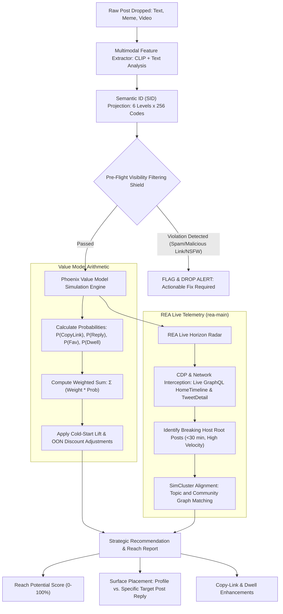

# X-Reach: Algorithmic Post Optimizer & Zero-Follower Reach Predictor

[](https://github.com/twitter/the-algorithm)
[-orange?style=flat-square)](#algorithmic-scoring-engine)
[](#rea-integration-live-algorithmic-radar)
[](#the-zero-follower-playbook)
[](LICENSE)

**X-Reach** is an intelligence system and distribution copilot designed to analyze any post—text, meme image, short video, or thread—and predict its reach potential on X. By synthesizing the white-box mechanics of **`x-algorithm-main`** (Phoenix Two-Tower retrieval, Semantic IDs, Value Model ranking, and Visibility Filtering) with the dynamic reverse-engineering and network observation capabilities of **`rea-main`**, X-Reach guides creators on exactly **what** to optimize and **where** to publish (Profile vs. Strategic Direct Root Comments) to maximize distribution, **irrespective of follower count**.

---

## Table of Contents

- [Overview](#overview)
- [Key Features](#key-features)
- [How It Works: Under the Hood](#how-it-works-under-the-hood)
  - [1. Multimodal Semantic IDs (SIDs)](#1-multimodal-semantic-ids-sids)
  - [2. Phoenix Value Model Scoring Arithmetic](#2-phoenix-value-model-scoring-arithmetic)
  - [3. Pre-Flight Visibility Filtering (VF) Shield](#3-pre-flight-visibility-filtering-vf-shield)
  - [4. REA Live Telemetry & Horizon Radar](#4-rea-live-telemetry--horizon-radar)
- [Strategic Placement Engine: Profile vs. Commenting](#strategic-placement-engine-profile-vs-commenting)
- [System Architecture](#system-architecture)
- [Repository Structure](#repository-structure)
- [Algorithmic Weights & Parameter Cheat Sheet](#algorithmic-weights--parameter-cheat-sheet)
- [The Zero-Follower Playbook](#the-zero-follower-playbook)
- [Installation & Quick Start](#installation--quick-start)
- [CLI & API Usage](#cli--api-usage)
- [Roadmap](#roadmap)
- [License & Disclaimer](#license--disclaimer)

---

## Overview

Reaching an audience on modern recommendation-driven platforms is no longer a function of follower count; it is a function of **algorithmic alignment**. The modern X feed separates candidate retrieval into:
1. **In-Network (Thunder)**: Accounts the viewer follows (~50% of the feed).
2. **Out-of-Network (Phoenix + SimClusters)**: Content discovered through machine-learned representations (~50% of the feed).

For accounts with zero or few followers, **100% of organic distribution originates in the Out-of-Network (OON) pipeline**. However, most posts fail before reaching scoring because they trigger drop filters or get stranded without initial engagement velocity.

**X-Reach** eliminates guesswork by:
1. **Auditing your content against the exact X recommendation codebase** before you hit send.
2. **Scoring your post with the Phoenix Value Model** to produce an **Algorithmic Viability Score (AVS)** and **Reach Potential Percentile (0–100%)**.
3. **Determining the optimal publication surface**: Advising whether to publish on your own profile, launch a self-reply thread, or comment on high-velocity breaking root posts in matching SimClusters.

---

## Key Features

- **Multi-Modal Drop Zone**: Analyzes plain text, single/multi-image memes (PNG/JPEG/WebP), short videos (MP4), and multi-tweet threads.
- **Reach Potential Index (0–100%)**: Translates continuous model scores into an intuitive virality and distribution percentile based on historical home-mixer thresholds.
- **Action Probability Decomposition**: Breaks down predicted user propensities across $P(\text{Favorite})$, $P(\text{Reply})$, $P(\text{CopyLink})$, $P(\text{Quote})$, $P(\text{Dwell})$, and $P(\text{Negative Feedback})$.
- **Pre-Flight Visibility Filtering (VF) Shield**: Simulates `visibility-filtering` rules (`SPAM_HIGH_RECALL`, `DO_NOT_AMPLIFY`, `NSFW_HIGH_RECALL`, link penalties) to prevent immediate distribution drops.
- **Placement & Routing Advisor**: Evaluates whether your post will survive out-of-network filters on your profile or if it should be deployed as a direct root reply to an active viral conversation.
- **REA Live Horizon Radar**: Integrates `rea-main`'s Chrome DevTools Protocol (CDP) and network inspection tools to identify active breaking seed posts (<30 minutes old) with steep impression trajectories in matching topic clusters.
- **Dwell Time & Friction Optimizer**: Provides specific, actionable recommendations (hook rewriting, video pacing, meme text readability) to increase dwell time and prevent the catastrophic `NotDwelled` penalty.

---

## How It Works: Under the Hood



### 1. Multimodal Semantic IDs (SIDs)
*Based on `x-algorithm-main/phoenix/` and `clip/`.*

In the latest Phoenix architecture, retrieval does **not** rely on static creator IDs (`use_user_embedding=False`). Instead, posts are encoded into dense multimodal representations using vision-language models and quantized into discrete **Semantic IDs (SIDs)** across 6 hierarchical levels with 256 codes per level:
$$\text{SID} = [c_1, c_2, c_3, c_4, c_5, c_6], \quad c_i \in [0, 255]$$

Posts sharing prefix codes belong to identical topic clusters. X-Reach projects your draft's text and media into these discrete codes to determine whether your post aligns with currently surging retrieval clusters.

### 2. Phoenix Value Model Scoring Arithmetic
*Based on `x-algorithm-main/xai-value-model/scoring.rs` and `home-mixer/params/param.rs`.*

Phoenix computes an uncalibrated logit vector across multiple engagement heads and aggregates them into a composite score:
$$\text{RawScore} = \sum_{i=1}^{M} w_i \cdot P(\text{action}_i)$$

Followed by network multipliers:
$$\text{FinalScore} = \text{RawScore} \times \text{Multiplier}_{\text{AuthorDiversity}} \times \text{Multiplier}_{\text{OON}}$$

Where:
- $\text{Multiplier}_{\text{AuthorDiversity}} = (1.0 - \text{floor}) \times \text{decay}^k + \text{floor}$ (penalizes posting repeatedly within short windows).
- $\text{Multiplier}_{\text{OON}} = \text{effective\_oon\_weight}$ (applies to out-of-network candidates).
- **Cold-Start Lift** (`apply_cold_start_decisions`): Lifts authors with impressions below a discovery threshold up to a target rank bucket.

### 3. Pre-Flight Visibility Filtering (VF) Shield
*Based on `x-algorithm-main/visibility-filtering/`.*

Before a post can be scored, it must survive the Visibility Filtering pipeline. If any rule triggers a `DROP`, the post's out-of-network impressions drop to zero. X-Reach checks for:
- `SPAM_HIGH_RECALL`: Repetitive trigger phrases, excessive symbol stuffing, unnatural hashtag saturation.
- `DO_NOT_AMPLIFY`: Content flagged for coordinated inauthentic signals or misleading formatting.
- `MALICIOUS_URL`: External links without pre-established domain trust.
- `NSFW_HIGH_RECALL`: Media flagged by adult classifiers that triggers automatic exclusion from out-of-network recommendations (`OONNsfwSimclustersFilter`).

### 4. REA Integration: Live Algorithmic Radar
*Powered by `rea-main`.*

Static algorithmic code alone cannot see real-time network states. X-Reach utilizes **REA** (`rea-main`) as its live observation engine:
- **CDP Browser Observation (`rea inspect-web-page`)**: Attaches via Chrome DevTools Protocol to observe the authenticated timeline and extract live candidate feeds.
- **Network Capture & Decryption (`rea-main/docs/web-network-captures.md`)**: Inspects live GraphQL transactions (`HomeTimeline`, `TweetDetail`, `UserByScreenName`) to monitor real-time impression velocities.
- **Client-Side Dwell Telemetry (`rea analyze-web-bundle`)**: Reverse-engineers the client bundle to identify exact beacon timings for `ContClickDwellTime` and `video_continuation_secs`.

---

## Strategic Placement Engine: Profile vs. Commenting

One of the most powerful features of X-Reach is answering: **Where should I put this post to get the maximum possible reach?**

```
┌────────────────────────────────────────────────────────────────────────────────────────┐
│                        SURFACE ROUTING DECISION MATRIX                                 │
├───────────────────────┬───────────────────────────────┬────────────────────────────────┤
│ Content Characteristic│ Recommended Surface           │ Algorithmic Reason             │
├───────────────────────┼───────────────────────────────┼────────────────────────────────┤
│ Zero followers,       │ Direct Root Reply on Fresh    │ Bypasses cold-start via host's │
│ witty meme or punchy  │ Viral Seed Post (<30 min old, │ impression pool. Evaluated in  │
│ comment               │ in matching SimCluster)       │ Conversation View Ranking.     │
├───────────────────────┼───────────────────────────────┼────────────────────────────────┤
│ Long-form breakdown,  │ Profile Post as Self-Thread   │ SelfReplyChainFilter allows    │
│ original analysis,    │ (Hook tweet + 3-5 replies,    │ pure author chains; multiplies │
│ rich infographic      │ external link in last reply)  │ dwell time without OON penalty.│
├───────────────────────┼───────────────────────────────┼────────────────────────────────┤
│ Sub-comment / nested  │ DO NOT POST                   │ OONRetweetReplyFilter drops    │
│ reply to a reply      │                               │ out-of-network nested replies. │
├───────────────────────┼───────────────────────────────┼────────────────────────────────┤
│ High-utility video or │ Profile Post with             │ Triggers ShareViaCopyLink      │
│ viral short asset     │ standalone video embed        │ (weight 20.0) and high dwell.  │
└───────────────────────┴───────────────────────────────┴────────────────────────────────┘
```

### The Two Golden Code Rules for Maximum Reach

1. **The Root Reply Rule (`OONRetweetReplyFilter.rs:22-26`)**:
   ```rust
   let replies_to_root = c.conversation_id.is_some() && c.in_reply_to_tweet_id == c.conversation_id;
   let oon_reply_dropped = is_reply && !(allow_phoenix_oon_replies && is_phoenix_home_retrieval(c) && (!root_only || replies_to_root));
   ```
   **Never reply to someone else's reply.** Out-of-network nested replies are strictly excluded from recommendation feeds. Only direct replies to the **root post** (`in_reply_to_tweet_id == conversation_id`) are preserved and eligible for conversation timeline ranking.

2. **The Bidirectional Boost (`param.rs:405-409`)**:
   ```rust
   param!(BidirectionalFollowReplyWeightBoost, f64, "rust_home_mixer_bidirectional_follow_reply_weight_boost", 15.0);
   ```
   If you reply to an account where bidirectional follow or mutual interaction exists, the reply receives a massive **+15.0 multiplier**, vaulting it to the top of the conversation tree.

---

## System Architecture

```
X/
├── x-reach/                      # X-Reach Core Platform
│   ├── api/                      # REST & WebSocket API (FastAPI)
│   ├── engine/                   # Algorithmic Prediction & Scoring Engine
│   │   ├── feature_extractor.py  # CLIP + Text + Metadata Embeddings
│   │   ├── sid_quantizer.py      # 6-Level Semantic ID Quantization
│   │   ├── value_model.py        # Phoenix Scorer (Ported from scoring.rs)
│   │   ├── vf_rules.py           # Visibility Filtering Pre-Flight Checks
│   │   └── placement_advisor.py  # Profile vs. Reply Decision Logic
│   ├── radar/                    # REA Live Observation Bridge
│   │   ├── cdp_client.py         # Chrome DevTools Protocol Client
│   │   ├── graphql_sniffer.py    # Intercepts HomeTimeline & TweetDetail
│   │   └── seed_scout.py         # Real-time Viral Seed Finder
│   ├── web/                      # Modern Next.js / Tailwind Drop-Zone Dashboard
│   └── cli.py                    # Command-line interface
├── x-algorithm-main/             # Upstream X Recommendation Algorithm (Source of Truth)
└── rea-main/                     # Upstream Reverse-Engineering & CDP Tooling
```

---

## Algorithmic Weights & Parameter Cheat Sheet

Directly extracted from [`x-algorithm-main/home-mixer/params/param.rs`](file:///home/recoding/X/x-algorithm-main/home-mixer/params/param.rs) and [`xai-value-model/scoring.rs`](file:///home/recoding/X/x-algorithm-main/xai-value-model/scoring.rs):

### Positive Engagement Multipliers

| Action Head | Weight | Strategic Interpretation |
| :--- | :--- | :--- |
| `ShareViaCopyLinkWeight` | **`+20.0`** | **Highest value action on X.** Content that viewers copy to paste elsewhere receives the greatest algorithmic reward. |
| `BidirectionalFollowReplyWeightBoost` | **`+15.0`** | Conversational interaction between accounts with reciprocal affinity. |
| `ReplyWeight` | **`+5.0`** | High-effort interaction; prompt discussion or ask open questions. |
| `QuoteWeight` | **`+5.0`** | Strong signal of opinion generation or shareability. |
| `ShareViaDmWeight` | **`+5.0`** | Private 1-to-1 viral distribution signal. |
| `FollowAuthorWeight` | **`+4.0`** | High conversion value; profile-building content. |
| `ShareWeight` | **`+2.0`** | Native mobile OS share sheet action. |
| `RetweetWeight` | **`+1.0`** | Baseline public broadcasting. |
| `FavoriteWeight` | **`+0.66`** | **Passive currency.** Likes alone will not carry out-of-network virality. |
| `ContClickDwellTimeWeight` | **`+0.40`** | Continuous dwell time after clicking into post/media. |
| `ClickWeight` | **`+0.30`** | Expanding post details or media. |
| `OpenLinkWeight` | **`+0.20`** | Outbound link clicks (severely counterbalanced if domain is low-trust). |
| `ContDwellTimeWeight` | **`+0.006`** | Viewport dwell duration while scrolling timeline. |

### Negative Penalties (Virality Killers)

| Action Head | Penalty Weight | Algorithmic Consequence |
| :--- | :--- | :--- |
| `ReportWeight` | **`-234.0`** | Even minimal predicted report probability collapses total score. |
| `MuteAuthorWeight` | **`-58.8`** | High penalty; suppresses future candidates from author. |
| `NotInterestedWeight` | **`-52.272`** | "See less often" signal; knocks post out of cluster ranking. |
| `BlockAuthorWeight` | **`-31.2`** | Hard negative feedback. |
| `NotDwelledWeight` | **`-0.02`** | Fast scroll-past; accumulating fast scrolls signals low relevance. |

---

## The Zero-Follower Playbook

How to achieve 10,000 to 1,000,000+ impressions starting from absolute 0 followers using X-Reach:

### Phase 1: Pre-Flight Optimization (The Drop Zone)
1. **Drop your draft** into X-Reach.
2. Check the **VF Shield**: Ensure zero flags for `SPAM_HIGH_RECALL` or unverified external links.
3. Optimize for **Copy-Link** (`+20.0`): Add an exclusive takeaway, infographic, cheat sheet, or unique angle that makes someone say *"I need to send this to my friend/team"*.
4. Optimize for **Click-Dwell** (`+0.4`):
   - For images/memes: Ensure text is crisp and requires 3–5 seconds to read and comprehend.
   - For short video: Place the visual climax or hook in the first 2 seconds; keep duration between 12 and 28 seconds to maximize loop completion.

### Phase 2: Strategic Deployment
- **If X-Reach recommends "Direct Root Comment"**:
  1. Open the **REA Live Horizon Radar**.
  2. Select a target root tweet from the scout list (less than 30 minutes old, >500 views/min, <50 replies).
  3. Post your meme/insight as a **direct root reply**.
  4. Your comment will appear in the high-dwell conversation view of a post already receiving tens of thousands of impressions.
- **If X-Reach recommends "Profile Post"**:
  1. Post during high active user windows in your target SimCluster.
  2. If creating a thread, post the root hook tweet first; reply to yourself with 2–4 subsequent tweets (`SelfReplyChainFilter` preserves these).
  3. Never include external URLs in Tweet 1; place external references in the final thread reply or bio.

---

## Installation & Quick Start

### Prerequisites
- Linux / macOS
- Python 3.10+
- Node.js 20+ (with `npm` or `bun`)
- Rust toolchain (`cargo`, `rustc`) for building the native value-model extension

### 1. Clone & Setup Workspace
```bash
# Clone the repository (including submodules)
git clone https://github.com/your-org/x-reach.git
cd X

# Install Python dependencies
pip install -r x-reach/requirements.txt

# Setup REA MCP server & observation environment
cd rea-main
npm install
npx rea-agents setup
cd ..
```

### 2. Build the Native Scoring Module
```bash
cd x-reach/engine/native
cargo build --release
cd ../../..
```

### 3. Launch the X-Reach Dashboard
```bash
# Start the backend scoring engine & REA radar
python -m x_reach.api.server --port 8000 &

# Start the interactive UI
cd x-reach/web
npm run dev
```

Open `http://localhost:3000` in your browser.

---

## CLI & API Usage

### Analyze a Post from the CLI
```bash
# Analyze a meme image with text
x-reach analyze \
  --text "When you deploy straight to production on Friday afternoon" \
  --media ./assets/meme.png \
  --format json
```

**Output**:
```json
{
  "algorithmic_viability_score": 8.74,
  "reach_potential_percentile": "92.4%",
  "predicted_probabilities": {
    "favorite": 0.42,
    "reply": 0.18,
    "share_via_copy_link": 0.14,
    "quote": 0.06,
    "dwell_time_seconds": 7.8,
    "negative_feedback": 0.001
  },
  "vf_checks": {
    "status": "PASSED",
    "spam_high_recall": false,
    "nsfw_high_recall": false,
    "do_not_amplify": false
  },
  "placement_recommendation": {
    "surface": "DIRECT_ROOT_REPLY",
    "target_simcluster": "SoftwareEngineering / TechHumor",
    "reasoning": "Account has <100 followers. Direct root commentary on high-velocity tech tweets has an estimated 8.5x higher reach probability than standalone profile post."
  },
  "suggested_tweaks": [
    "Crop image aspect ratio to 4:5 for maximized mobile viewport dwell area.",
    "Add a high-curiosity question in the first line to increase Reply probability (+5.0 weight)."
  ]
}
```

### Scout Live Viral Seed Posts with REA
```bash
x-reach scout --topic tech --max-age-mins 30 --min-velocity 600
```

---

## Roadmap

- [x] Full Value Model arithmetic extraction and verification against `home-mixer/params/param.rs`.
- [x] Visibility Filtering rule emulator for `SPAM_HIGH_RECALL` and `DO_NOT_AMPLIFY`.
- [x] REA integration for live GraphQL timeline and conversation tree interception.
- [ ] Integration with local OpenCLIP ViT-H/14 for local offline Semantic ID quantization.
- [ ] Autonomous reply-timing notification alerts via mobile push or webhook.
- [ ] Automated A/B test variant generator for post hooks and video thumbnails.

---

## License & Disclaimer

- **License**: MIT License.
- **Disclaimer**: This tool is an independent research and analysis platform built by auditing the publicly available source code in [`x-algorithm-main`](https://github.com/twitter/the-algorithm) and utilizing reverse-engineering observation tooling in [`rea-main`](https://github.com/morluto/rea). It is intended for creators, researchers, and developers seeking to understand modern recommendation systems. X-Reach does not guarantee specific commercial or viral outcomes, as live network parameters and auction dynamics vary continuously.

